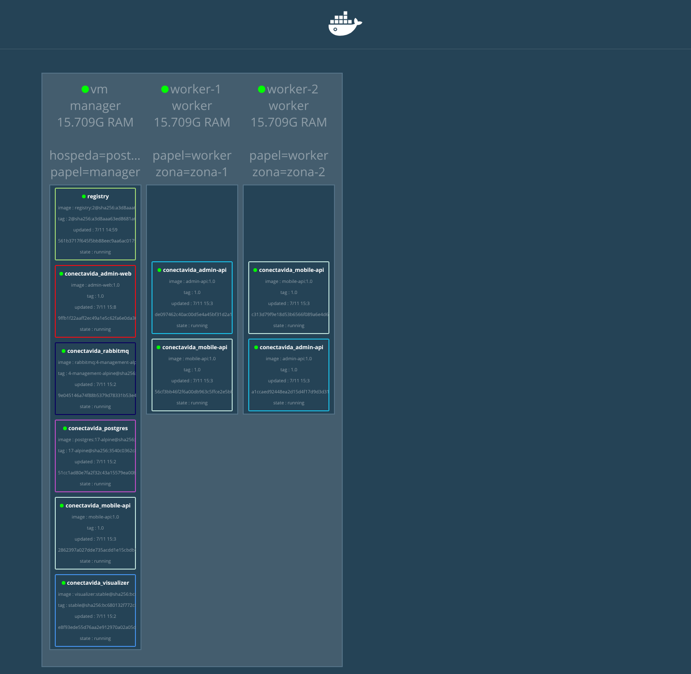

# Conecta Vida no Docker Swarm

Guia da atividade de **conteinerização e orquestração**: as imagens, a stack, o cluster de 3 nós e o roteiro do seminário.



🎬 **Vídeo da demonstração:** [`midia/demo-conectavida-swarm.mp4`](midia/demo-conectavida-swarm.mp4). Ele mostra o cluster, o escalonamento ao vivo e o painel web consumindo a API dentro do Swarm.

---

## 1. Arquitetura

```
                       ┌──────────── rede overlay: conectavida-net ────────────┐
 Navegador ──8088──▶ admin-web (Nginx) ──/api──▶ admin-api ──┐                 │
                                                  (8080)     ├──▶ postgres     │
 App Flutter ──8081──────────────────────────▶ mobile-api ───┘    (5432)       │
                                                  ▲                            │
                       admin-api ──publica──▶ rabbitmq ──entrega──┘            │
                                              (5672/15672)                     │
 Navegador ──8085──▶ visualizer (lê o docker.sock do manager)                  │
                       └───────────────────────────────────────────────────────┘
```

| # | Serviço | Imagem | Porta | Réplicas | Onde roda |
|---|---------|--------|-------|----------|-----------|
| 1 | `postgres` | `postgres:17-alpine` | 5432 | 1 | manager |
| 2 | `rabbitmq` | `rabbitmq:4-management-alpine` | 5672 / 15672 | 1 | manager |
| 3 | `admin-api` | `conectavida/admin-api:1.0` (nossa) | 8080 | 2 | qualquer nó |
| 4 | `mobile-api` | `conectavida/mobile-api:1.0` (nossa) | 8081 | 3 | qualquer nó |
| 5 | `visualizer` | `dockersamples/visualizer:stable` | 8085 | 1 | manager |
| 6 | `admin-web` | `conectavida/admin-web:1.0` (nossa, front) | 8088 | 2 | qualquer nó |

Todas as imagens usam **Alpine Linux**.

### Por que dividir em `admin-api` e `mobile-api`?

O backend é **um único projeto Gradle com três módulos**:

| Módulo | O que contém |
|--------|--------------|
| `core` | Entidades JPA, repositórios, serviços, configuração do RabbitMQ e as rotas usadas pelos dois clientes (`/api/auth`, `/api/usuarios`, `/api/comunicacoes`, inscrições em campanhas) |
| `admin-api` | Rotas exclusivas do painel: dashboard, alertas, campanhas, instituições, logs e relatórios |
| `mobile-api` | Rotas exclusivas do app (`/api/push`), o **consumidor da fila** do RabbitMQ que dispara as notificações push e um filtro que **bloqueia (403)** as operações de gestão herdadas do `core` (criar/excluir comunicações, listar todos os usuários, CSV) |

Assim cada API escala de forma independente. No dia de uma campanha de vacinação, por exemplo, só a `mobile-api` precisa de mais réplicas.

### Para que serve o RabbitMQ?

Quando o gestor publica um **ALERTA** no painel, a `admin-api` não envia o push diretamente. Ela publica um evento na exchange `conectavida.eventos`. A fila `conectavida.push` entrega cada mensagem para **uma única** réplica da `mobile-api` (padrão *competing consumers*). Essa réplica busca no banco os tokens dos celulares e chama o Firebase.

Os tokens dos celulares ficam no **banco**, na tabela `dispositivos_push`. Antes eles ficavam na memória de um único processo: com várias réplicas, cada uma teria uma lista diferente e o push nunca chegaria a todos.

---

## 2. Os Dockerfiles explicados

### 2.1 `admin-api/Dockerfile` (backend Java)

O `mobile-api/Dockerfile` é idêntico. Só mudam o módulo (`:mobile-api`) e a porta (8081).

```dockerfile
FROM eclipse-temurin:17-jdk-alpine AS build
```
**Estágio 1 (build).** Imagem com o **JDK 17** completo (compilador) sobre Alpine. O apelido `AS build` permite copiar arquivos deste estágio mais tarde.

```dockerfile
WORKDIR /workspace
COPY gradlew settings.gradle build.gradle ./
COPY gradle ./gradle
COPY core/build.gradle core/
COPY admin-api/build.gradle admin-api/
COPY mobile-api/build.gradle mobile-api/
RUN chmod +x gradlew \
    && ./gradlew --no-daemon -q :admin-api:dependencies --configuration runtimeClasspath > /dev/null
```
Copia **só os arquivos de build** e baixa as dependências. O Docker guarda esta camada em cache: enquanto os `build.gradle` não mudarem, um novo build não baixa o Spring de novo. O `settings.gradle` declara os três módulos, então os três `build.gradle` precisam existir.

```dockerfile
COPY core/src core/src
COPY admin-api/src admin-api/src
RUN ./gradlew --no-daemon :admin-api:bootJar -x test
```
Agora copia o código-fonte do **módulo compartilhado `:core`** e o da API, e gera o JAR executável `admin-api/build/libs/app.jar`. O Gradle compila o `:core` antes, porque a `admin-api` depende dele.

```dockerfile
FROM eclipse-temurin:17-jre-alpine
WORKDIR /app
RUN addgroup -S conectavida && adduser -S conectavida -G conectavida
COPY --from=build --chown=conectavida:conectavida /workspace/admin-api/build/libs/app.jar app.jar
USER conectavida
```
**Estágio 2 (runtime).** Começa do zero com uma imagem que tem **só o JRE** (sem compilador, Gradle ou código-fonte). Do estágio de build vem apenas o `app.jar`. A aplicação roda com um **usuário sem privilégios**, e não como root, o que é uma boa prática de segurança.

```dockerfile
ENV SERVER_PORT=8080 \
    JAVA_OPTS="-XX:MaxRAMPercentage=75 -XX:+ExitOnOutOfMemoryError"
EXPOSE 8080
```
- `MaxRAMPercentage=75`: a JVM respeita o limite de memória do container (512 MB no compose).
- `ExitOnOutOfMemoryError`: se a memória acabar, o processo morre e o Swarm sobe outro.
- `EXPOSE`: documenta a porta usada.

```dockerfile
HEALTHCHECK --interval=15s --timeout=5s --start-period=60s --retries=5 \
  CMD wget -qO- http://127.0.0.1:8080/actuator/health/liveness || exit 1
ENTRYPOINT ["sh", "-c", "exec java $JAVA_OPTS -jar app.jar"]
```
- `HEALTHCHECK`: consulta o **Spring Actuator**. O Swarm só considera a réplica pronta quando ela responde, e a substitui se ela travar.
- `exec`: o Java vira o processo principal (PID 1) e recebe o sinal de parada do Docker corretamente.

> **Resultado do multi-stage:** a imagem final tem só o JRE e o JAR (sem JDK, Gradle ou cache de dependências) e roda Alpine Linux v3.24.

### 2.2 `admin-web/Dockerfile` (front-end React)

```dockerfile
FROM node:22-alpine AS build
WORKDIR /app
COPY package.json package-lock.json ./
RUN npm ci --no-audit --no-fund
```
**Estágio 1.** Node 22 sobre Alpine. Primeiro copia só os `package*.json` e instala as dependências com `npm ci`, que respeita exatamente o lock. Essa camada fica em cache.

```dockerfile
COPY . .
ARG VITE_API_URL=/api
ENV VITE_API_URL=$VITE_API_URL
RUN npm run build
```
Copia o código e gera o build de produção (TypeScript + Vite) na pasta `dist/`. A URL da API é `/api`, um caminho relativo: quem resolve é o Nginx do próprio container. Por isso não há problema de CORS.

```dockerfile
FROM nginx:1.27-alpine
COPY nginx/default.conf /etc/nginx/conf.d/default.conf
COPY --from=build /app/dist /usr/share/nginx/html
EXPOSE 80
HEALTHCHECK ... CMD wget -qO- http://127.0.0.1/healthz || exit 1
```
**Estágio 2.** Só o **Nginx** com os arquivos estáticos, sem Node nem `node_modules`. A imagem final tem cerca de **74 MB**.

O arquivo [`admin-web/nginx/default.conf`](../admin-web/nginx/default.conf) faz três coisas:
1. **`location /api/` → `proxy_pass http://admin-api:8080`**: encaminha as chamadas para o serviço `admin-api`. O nome é resolvido pelo DNS interno do Swarm (`resolver 127.0.0.11`), que distribui entre as réplicas.
2. **`try_files ... /index.html`**: garante que rotas do React como `/alertas` funcionem ao recarregar a página.
3. **`/assets/` com cache de 1 ano**: os arquivos têm hash no nome, então podem ser cacheados.

### 2.3 Imagens prontas

| Serviço | Por que esta imagem |
|---------|---------------------|
| `postgres:17-alpine` | Banco oficial, versão Alpine (menor) |
| `rabbitmq:4-management-alpine` | Inclui o painel web de gerenciamento na porta 15672 |
| `dockersamples/visualizer:stable` | Painel gráfico do livro *Descomplicando o Docker* |

---

## 3. O `docker-compose.yml` explicado

```yaml
x-api-env: &api-env
  DB_URL: jdbc:postgresql://postgres:5432/conectavida
  RABBITMQ_HOST: rabbitmq
  MENSAGERIA_ENABLED: "true"
  ...
```
**Âncora YAML**: as variáveis comuns às duas APIs ficam num lugar só e são reaproveitadas com `<<: *api-env`. Os hosts `postgres` e `rabbitmq` são **nomes de serviço**, resolvidos pelo DNS da rede overlay.

```yaml
  postgres:
    image: postgres:17-alpine
    volumes:
      - postgres-data:/var/lib/postgresql/data
    configs:
      - source: db-schema
        target: /docker-entrypoint-initdb.d/01-schema.sql
      - source: db-seed
        target: /docker-entrypoint-initdb.d/02-seed.sql
    deploy:
      placement:
        constraints: [node.role == manager]
```
- `volumes`: os dados sobrevivem a reinícios.
- `configs`: **Swarm configs** entregam os scripts SQL ao container. Na primeira inicialização o Postgres cria as tabelas (`01-schema.sql`) e os dados de demonstração (`02-seed.sql`). Diferente de um bind mount, um config funciona em qualquer nó.
- `constraints: [node.role == manager]`: o banco fica **sempre no manager**, junto do seu volume.

```yaml
  admin-api:
    image: ${REGISTRY:-127.0.0.1:5000}/conectavida/admin-api:${TAG:-1.0}
    depends_on: [postgres, rabbitmq]
    deploy:
      replicas: 2
      update_config:
        parallelism: 1
        order: start-first
      restart_policy:
        condition: on-failure
        delay: 10s
      resources:
        limits:   { memory: 512M }
        reservations: { memory: 128M }
```
- `image`: as imagens vêm do **registry local do cluster** (`127.0.0.1:5000`). Os workers não têm as imagens que você construiu na sua máquina, então elas precisam estar num registry que todos os nós alcancem.
- `depends_on`: o Swarm **ignora** essa opção, que fica só como documentação. Quem resolve a ordem de subida é a `restart_policy`: se a API subir antes do banco, ela falha e o Swarm tenta de novo depois de 10 s.
- `replicas`: quantidade inicial de réplicas (2 na admin-api, 3 na mobile-api).
- `update_config`: *rolling update*, uma réplica por vez, subindo a nova antes de derrubar a antiga (`start-first`). Assim a atualização não tem downtime. Cada réplica nova é observada por 30 s (`monitor`), e se falhar o Swarm **volta sozinho para a versão anterior** (`failure_action: rollback`). Para demonstrar: `TAG=1.1 docker stack deploy ...` com uma imagem nova.
- `resources`: o `limit` impede uma réplica de consumir toda a RAM do nó. A `reservation` é a memória que o scheduler garante ao escolher o nó.

```yaml
  visualizer:
    image: dockersamples/visualizer:stable
    ports: ["8085:8080"]
    volumes:
      - /var/run/docker.sock:/var/run/docker.sock:ro
    deploy:
      placement:
        constraints: [node.role == manager]
```
O Visualizer lê o estado do cluster pelo **socket do Docker** (somente leitura). Só o manager conhece o cluster inteiro, por isso a constraint.

```yaml
networks:
  conectavida-net:
    driver: overlay
    attachable: true
```
A rede **overlay** liga containers que estão em **nós diferentes** como se estivessem na mesma rede local. Com `attachable: true` dá para conectar um container avulso a ela para testes.

**`deploy.labels`** (`conectavida.camada: backend-mobile` etc.) classificam cada serviço por camada, e o **script do seminário etiqueta os nós** (`papel=manager/worker`, `zona=zona-1/zona-2`). Essas etiquetas aparecem no Visualizer e diferenciam o nosso projeto.

---

## 4. Como rodar (passo a passo)

### Passo 0: pré-requisitos
- **Docker Desktop** (Windows/Mac) ou **Docker Engine** (Linux).
- No Windows, use o **Git Bash** ou o **WSL** para rodar o script `.sh`.

```bash
docker --version
docker compose version
```

### Opção A: tudo automático (recomendado para o seminário)

Na **raiz do repositório**:

```bash
./infra/swarm/seminario.sh subir
```

O script executa todo o roteiro do professor:
1. Ativa o Swarm (`docker swarm init`).
2. **Tarefa 1:** constrói as 3 imagens (`admin-api`, `mobile-api`, `admin-web`).
3. Cria o registry local (`127.0.0.1:5000`) e envia as imagens para ele.
4. **Tarefa 3.1:** cria `worker-1` e `worker-2` com `docker:dind`.
5. **Tarefa 3.2:** pega o token (`docker swarm join-token worker`) e conecta os dois workers.
6. Etiqueta os nós (as etiquetas aparecem no Visualizer).
7. **Tarefa 3.3:** `docker stack deploy -c docker-compose.yml conectavida`.

Depois de cerca de 1 minuto:

| O quê | Endereço |
|-------|----------|
| **Visualizer** | http://localhost:8085 |
| **Painel admin** | http://localhost:8088 (login `admin@conectavida.com` / `admin123`) |
| admin-api | http://localhost:8080/actuator/health |
| mobile-api | http://localhost:8081/actuator/health |
| RabbitMQ | http://localhost:15672 (`conectavida` / `conectavida`) |

**Tarefa 3.5: escalabilidade ao vivo** (deixe o Visualizer aberto no projetor):

```bash
./infra/swarm/seminario.sh escalar
```

Esse comando executa:

```bash
docker service scale conectavida_mobile-api=6
docker service scale conectavida_admin-api=4
docker service scale conectavida_mobile-api=2
```

Ver o estado do cluster e, ao final, desmontar tudo:

```bash
./infra/swarm/seminario.sh status
```

```bash
./infra/swarm/seminario.sh derrubar
```

### Opção B: comando por comando (para explicar cada etapa)

```bash
docker swarm init
```

```bash
docker build -t conectavida/admin-api:1.0 -f admin-api/Dockerfile .
```

```bash
docker build -t conectavida/mobile-api:1.0 -f mobile-api/Dockerfile .
```

```bash
docker build -t conectavida/admin-web:1.0 -f admin-web/Dockerfile admin-web
```

Registry local e envio das imagens:

```bash
docker service create --name registry --publish published=5000,target=5000 --constraint node.role==manager registry:2
```

```bash
for img in admin-api mobile-api admin-web; do docker tag conectavida/$img:1.0 127.0.0.1:5000/conectavida/$img:1.0; docker push 127.0.0.1:5000/conectavida/$img:1.0; done
```

Workers Docker-in-Docker:

```bash
docker run -d --privileged --name worker-1 --hostname worker-1 docker:dind
```

```bash
docker run -d --privileged --name worker-2 --hostname worker-2 docker:dind
```

Conectar os workers. O IP do manager, visto de dentro dos containers, é o gateway da rede bridge (normalmente `172.17.0.1`):

```bash
docker swarm join-token worker
```

```bash
docker exec worker-1 docker swarm join --token <TOKEN> 172.17.0.1:2377
```

```bash
docker exec worker-2 docker swarm join --token <TOKEN> 172.17.0.1:2377
```

```bash
docker node ls
```

Deploy:

```bash
docker stack deploy -c docker-compose.yml conectavida
```

> Se o Swarm já tiver sido iniciado com outro IP, os workers DinD podem não alcançá-lo. Nesse caso, use `docker swarm leave --force` e depois `docker swarm init --advertise-addr 172.17.0.1`. O script já faz isso automaticamente.

### Variáveis de ambiente
Os valores padrão servem para o laboratório. Para trocar senhas, copie `.env.example` para `.env`, edite e exporte antes do deploy (`set -a; . ./.env; set +a`). O `docker stack deploy` **não** lê o `.env` sozinho.

---

## 5. Testes realizados

Ambiente: 1 manager + 2 workers `docker:dind`.

| Teste | Resultado |
|-------|-----------|
| Build das 3 imagens (multi-stage, Alpine) | ✅ |
| Stack com 6 serviços, réplicas distribuídas nos 3 nós | ✅ |
| Postgres inicializado pelos configs (schema + dados) e APIs com `ddl-auto=validate` | ✅ |
| Login do admin pelo painel (admin-web → Nginx → admin-api → Postgres) | ✅ |
| Token registrado na `mobile-api` (worker-1) e visível para as réplicas de outros nós | ✅ |
| ALERTA criado na `admin-api` → RabbitMQ → consumido por **uma** réplica da `mobile-api` | ✅ |
| `docker service scale` 6/4/2 refletido no Visualizer | ✅ (ver vídeo) |
| Rolling update 1.0 → 1.1 com réplicas nos 3 nós | ✅ |
| mobile-api bloqueia rotas de gestão (403) e libera as do app (200) | ✅ (+ 20 testes em `./gradlew :mobile-api:test`) |

---

## 6. Problemas comuns

| Sintoma | Causa / solução |
|---------|-----------------|
| Réplica em `Rejected` com "No such image" | A imagem não está no registry. Rode o `docker push` para `127.0.0.1:5000`. |
| Workers não entram no Swarm | O manager foi iniciado com outro IP. Rode `docker swarm leave --force` e depois `docker swarm init --advertise-addr 172.17.0.1`. |
| API reiniciando nos primeiros segundos | É normal: ela subiu antes do Postgres. A `restart_policy` resolve sozinha. |
| Mudou o `02-seed.sql` e nada aconteceu | Os scripts só rodam com o volume vazio. Rode `docker stack rm conectavida`, espere alguns segundos e depois `docker volume rm conectavida_postgres-data`. |
| Push não chega ao celular | Defina `FCM_SERVER_KEY` antes do deploy. Sem ela, o log mostra "Server Key não configurada". |
| Visualizer com `localhost:8085` fora do ar | A porta usa a *routing mesh* do Swarm, que precisa do módulo IPVS do kernel. Ele já vem no Docker Desktop e nas distros Linux comuns. |

## Limitações conhecidas
- O limite de 3 tentativas de login fica na memória de cada réplica: com várias réplicas da `admin-api`, cada uma conta separadamente.
- O "token" de login é simbólico (não é um JWT assinado) e as rotas não exigem autenticação. Isso vem do projeto original e está fora do escopo desta atividade.

## Segurança
- As senhas do compose são **de laboratório**. Em produção, use `.env` ou *Docker secrets*.
- O Visualizer acessa o socket do Docker: não o exponha publicamente.
- Credenciais que já estiveram em commits antigos (Supabase/SMTP) devem ser **rotacionadas**. Removê-las do arquivo atual não as apaga do histórico do Git.
