# Manual: como rodar e apresentar o Conecta Vida no Docker Swarm

Projeto **Conecta Vida**, IFSP Bragança Paulista.
Repositório: https://github.com/Conecta-Vida/Docker-Teste

Todas as fotos e vídeos deste manual foram feitos com o projeto rodando de verdade num cluster de 3 nós e estão na pasta [`documentacao/midia/`](midia/) do GitHub. A lista completa está na **Parte K**.

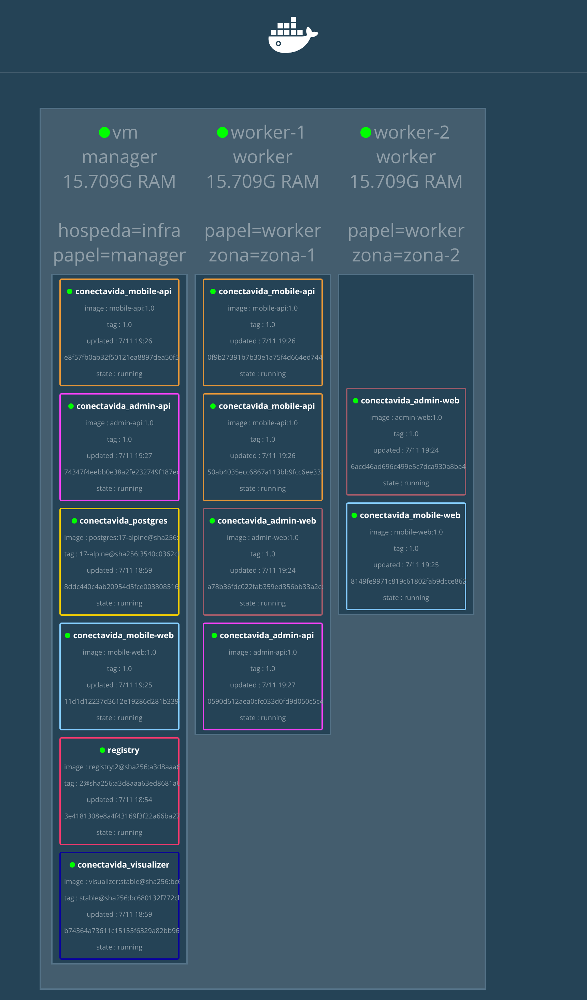

---

## Parte A: o que o professor pediu e onde está

| Requisito | Como atendemos | Onde mostrar |
|---|---|---|
| **1. Dockerfiles (imagens) dos serviços** | 5 imagens em Alpine Linux: `admin-api`, `mobile-api` (Java 21, multi-stage), `admin-web` (React + Nginx), `mobile-web` (Flutter Web + Nginx) e `painel-cluster` (Node.js) | `admin-api/Dockerfile`, `mobile-api/Dockerfile`, `admin-web/Dockerfile`, `mobile-app/Dockerfile` e `painel-cluster/Dockerfile` |
| **2. Docker Swarm com docker-in-docker** | Cluster de **3 nós**: o PC é o manager e `worker-1` e `worker-2` são containers `docker:dind` | Visualizer e `docker node ls` |
| **3. Docker Compose (infraestrutura como código), variação de réplicas e Visualizer** | `docker-compose.yml` descreve os 7 serviços, a rede, o volume e as réplicas. As réplicas mudam pelo arquivo (`replicas`) e pelo terminal (`docker service scale`) | `docker-compose.yml` e o Visualizer em http://localhost:8085 |
| **Diferencial no Visualizer** | **Painel do Cluster Conecta Vida**: um visualizador próprio, feito por nós, com o tema do projeto, eventos ao vivo e botões **+ / −** para escalar pela tela | http://localhost:8090 |

**Os 7 serviços da stack:**

| Serviço | O que é | Porta | Réplicas | Onde roda |
|---|---|---|---|---|
| `postgres` | Banco de dados | 5432 | 1 | Manager (fixo) |
| `admin-api` | API do painel do gestor | 8080 | 2 | Qualquer nó |
| `mobile-api` | API do app do cidadão | 8081 | 3 | Qualquer nó |
| `visualizer` | Painel gráfico do cluster | 8085 | 1 | Manager (fixo) |
| `admin-web` | Site do painel admin | 8088 | 2 | Qualquer nó |
| `mobile-web` | App do cidadão no navegador | 8089 | 2 | Qualquer nó |
| `painel-cluster` | **Diferencial:** Painel do Cluster Conecta Vida | 8090 | 1 | Manager (fixo) |

---

## Parte B: preparar o computador (uma vez só)

**B1.** Instale o **Docker Desktop**: https://www.docker.com/products/docker-desktop/

**B2.** Instale o **Git for Windows**, que traz o **Git Bash**: https://git-scm.com/download/win

**B3.** Abra o Docker Desktop e espere o ícone da baleia ficar parado, sem a mensagem "starting".

**B4.** Abra o **Git Bash** e confira se o Docker responde:

```bash
docker --version
```

```bash
docker compose version
```

**B5.** Baixe o projeto:

```bash
cd ~
```

```bash
git clone https://github.com/Conecta-Vida/Docker-Teste.git
```

```bash
cd Docker-Teste
```

> Todos os comandos deste manual são executados **no Git Bash**, dentro da pasta `~/Docker-Teste`. No PowerShell os scripts `.sh` não funcionam.

---

## Parte C: subir o projeto

**C1.** Atualize o projeto. Faça isso sempre antes de apresentar:

```bash
cd ~/Docker-Teste && git pull
```

**C2.** Se já rodou uma versão antiga antes, limpe tudo:

```bash
./infra/swarm/seminario.sh derrubar --apagar-dados
```

**C3.** Suba o cluster:

```bash
./infra/swarm/seminario.sh subir
```

O script faz tudo sozinho:
1. Ativa o Docker Swarm.
2. Constrói as 4 imagens. **Na primeira vez leva de 10 a 15 minutos**, porque baixa o Java, o Node e o Flutter. Depois fica rápido.
3. Cria o registry local e envia as imagens para ele.
4. Cria os workers `worker-1` e `worker-2` (Docker-in-Docker).
5. Conecta os workers ao manager e etiqueta os nós.
6. Faz o deploy: `docker stack deploy -c docker-compose.yml conectavida`.

> **O que é o registry?** Um "depósito de imagens" dentro do cluster (`127.0.0.1:5000`). As imagens são construídas no manager e enviadas para lá; os workers, que têm um Docker próprio e vazio, baixam as imagens dele. Para ver o conteúdo: `curl http://localhost:5000/v2/_catalog`.

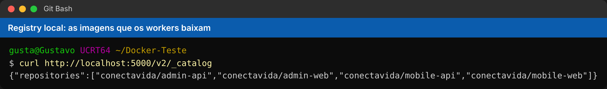

**C4.** Espere cerca de **1 minuto** e confira:

```bash
./infra/swarm/seminario.sh status
```

Está pronto quando:
- os 3 nós aparecem como `Ready`;
- todos os serviços mostram réplicas completas (`1/1`, `2/2`, `3/3`).

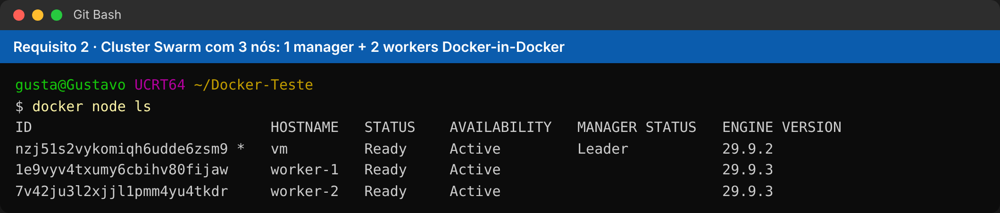

**C5.** Abra no navegador:

| O quê | Endereço | Login |
|---|---|---|
| Visualizer | http://localhost:8085 | (sem login) |
| **Painel do Cluster** (diferencial) | http://localhost:8090 | (sem login) |
| Painel admin | http://localhost:8088 | `admin@conectavida.com` / `admin123` |
| App do cidadão | http://localhost:8089 | `cidadao@conectavida.com` / `cidadao123` |
| Documentação das APIs | http://localhost:8080/swagger-ui.html | (sem login) |

> Para o app parecer de celular: aperte **F12** no Chrome e clique no ícone de celular (Ctrl+Shift+M).

| Painel admin | App do cidadão |
|---|---|
| 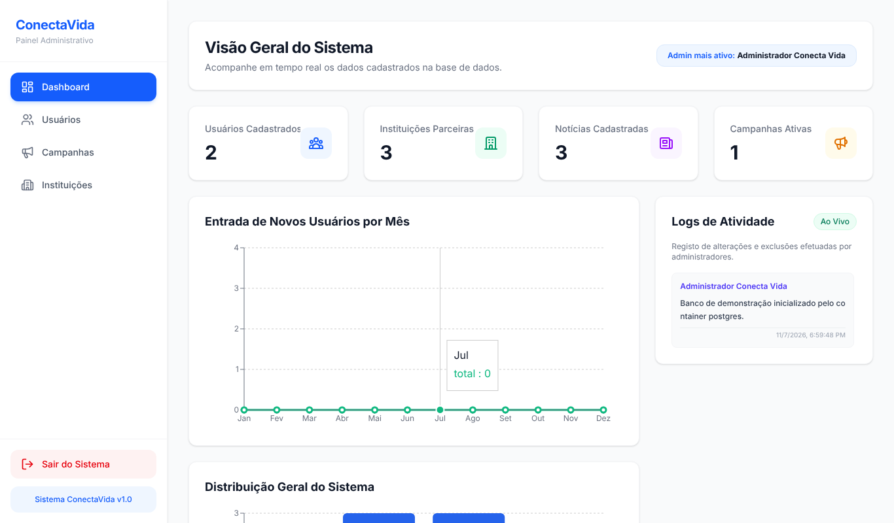 |  |

---

## Parte D (opcional): usar os dados reais do Supabase

O banco começa com dados de demonstração. Para trazer os dados que estavam no Supabase:

**D1.** Pegue a senha atual do banco em **Supabase → Project Settings → Database**.

**D2.** Com a stack rodando, no Git Bash:

```bash
export SUPABASE_DB_URL='postgresql://postgres.pborxjuuexiqollesfxw@aws-1-sa-east-1.pooler.supabase.com:5432/postgres'
```

```bash
export SUPABASE_DB_PASSWORD='cole-a-senha-aqui'
```

```bash
./infra/postgres/importar-supabase.sh
```

**D3.** Para os **logins antigos** funcionarem, o salt precisa ser o mesmo de antes. Ele está no `app.security.salt` dos `application.properties` antigos. Antes do `subir`, rode:

```bash
export CONECTA_API_SALT='valor-do-salt-antigo'
```

> O script só **lê** do Supabase e não altera nada lá. Se apagar os dados com `derrubar --apagar-dados`, rode a importação de novo.

---

## Parte E: preparar a apresentação (5 minutos antes)

**E1.** Confirme que tudo está no ar (Parte C4).

**E2.** Organize a tela:
- **Navegador** com 3 abas: Visualizer (8085), painel (8088) e app (8089).
- **VS Code** com estes arquivos abertos: `admin-api/Dockerfile`, `admin-web/Dockerfile` e `docker-compose.yml`.
- **Git Bash** com a fonte grande (Ctrl + roda do mouse).

**E3.** Faça login no painel e no app antes, para não perder tempo.

---

## Parte F: roteiro da apresentação (cerca de 14 minutos)

### F1. Abertura (1 min)
> "O Conecta Vida centraliza informações de saúde pública: o gestor publica campanhas e informativos pelo painel web e o cidadão recebe pelo aplicativo. Hoje vamos mostrar como colocamos o sistema inteiro em containers e orquestramos com o Docker Swarm."

### F2. Requisito 1: Dockerfiles (3 min, no VS Code)
Abra o `admin-api/Dockerfile` e explique:
> "Este Dockerfile é **multi-stage**. O primeiro estágio, `FROM eclipse-temurin:21-jdk-alpine AS build`, tem o JDK completo e compila o projeto com o Gradle. O segundo, `FROM eclipse-temurin:21-jre-alpine`, tem só o Java de execução e copia **apenas o `app.jar`**. A imagem final fica sem compilador nem código-fonte, roda em **Alpine Linux**, com um **usuário sem root** e um **healthcheck** que o Swarm usa para saber se a réplica está saudável."

Abra o `admin-web/Dockerfile`:
> "O front segue a mesma ideia: o Node compila o React e o Nginx entrega o site. A imagem final tem cerca de 74 MB. O Nginx também repassa as chamadas `/api` para a API dentro do cluster."

> "No total são 4 imagens nossas: as duas APIs, o painel e o app em versão web."

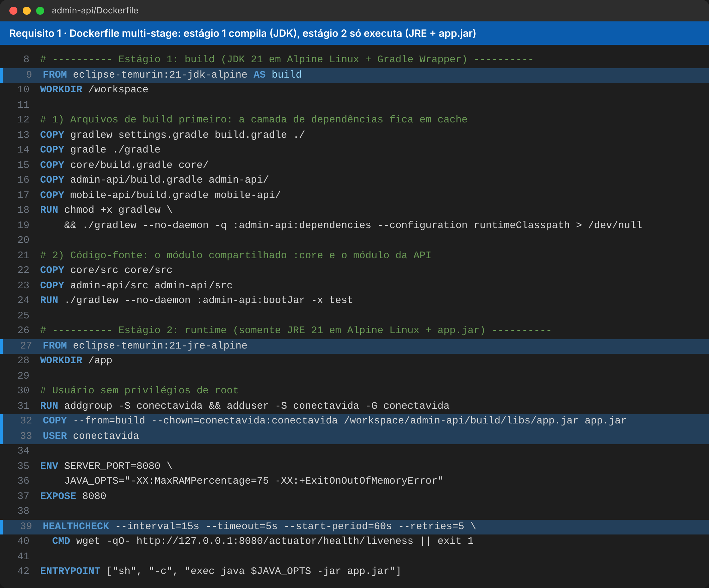

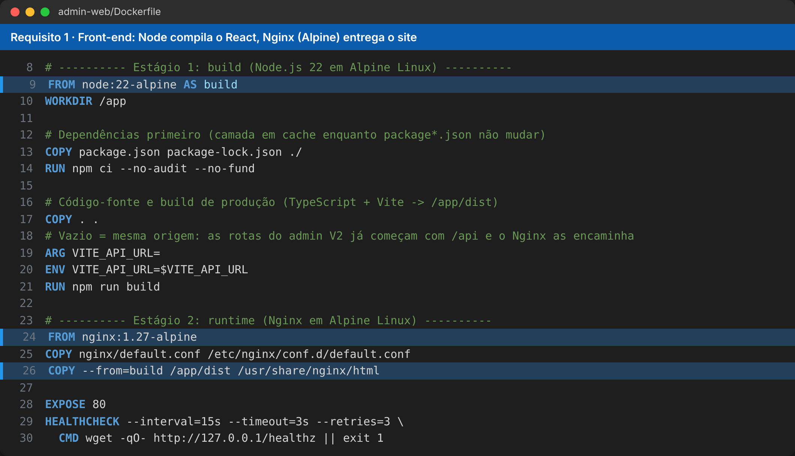

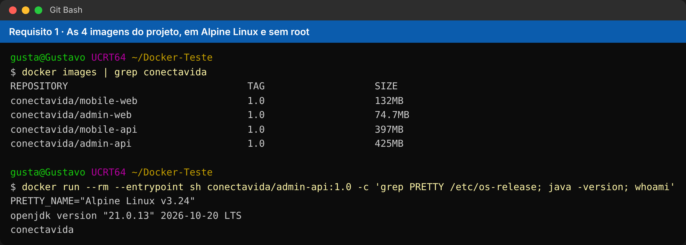

### F3. Iniciar o roteiro guiado
No Git Bash:

```bash
./infra/swarm/seminario.sh apresentar
```

O script mostra **em amarelo o que falar**, executa cada demonstração e espera você apertar **Enter**.

### F4. Requisito 2: Swarm (passos 1 e 2 do script, 2 min)
- **Passo 1, os nós:**
  > "Temos 3 nós. O **manager** coordena o cluster: decide onde cada container roda e recria o que falhar. Os **workers** executam os containers. Usamos **Docker-in-Docker**: cada worker é um container que roda um Docker dentro dele, simulando outra máquina."
- **Passo 2, o Visualizer:**
  > "O banco fica **fixo no manager** (`constraint: node.role == manager`), porque guarda dados. As APIs e os sites não guardam estado, então o Swarm **espalha as cópias** entre os nós. Caixas da mesma cor são réplicas do mesmo serviço."

🎬 **Vídeo:** [os 3 nós e o Visualizer (21 s)](https://github.com/Conecta-Vida/Docker-Teste/blob/main/documentacao/midia/video-1-cluster-3-nos.mp4)

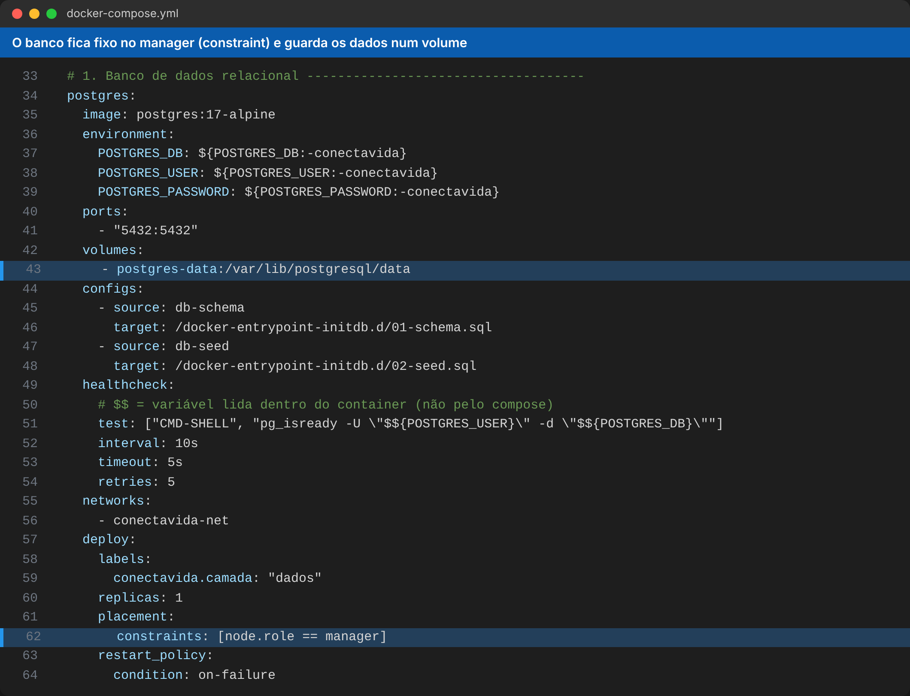

### F4b. Nosso diferencial: Painel do Cluster Conecta Vida (2 min)
O script abre http://localhost:8090 no passo 2. Mostre lado a lado com o Visualizer oficial.

> "Além do Docker Visualizer, criamos o **nosso próprio visualizador**, o Painel do Cluster Conecta Vida. Ele roda como mais um serviço da stack, com Dockerfile próprio, e conversa com a **API do Docker** pelo socket do manager. Mostra os 3 nós, as réplicas de cada serviço com ícones e cores, um **feed de eventos ao vivo** e tem **botões + e −** que escalam o serviço direto pela tela."

Demonstração:
1. Clique em **+** na `mobile-api` duas ou três vezes. As réplicas novas aparecem como `starting` e depois `rodando`, e o feed registra *"Réplica de mobile-api criada em worker-1"*.
2. Mostre que o **Visualizer oficial** (8085) também mudou: o painel altera o Swarm de verdade.
3. Tente o **+** no `postgres`: não há botão, ele é **fixo** (banco não é escalado).
4. Clique em **−** para voltar.

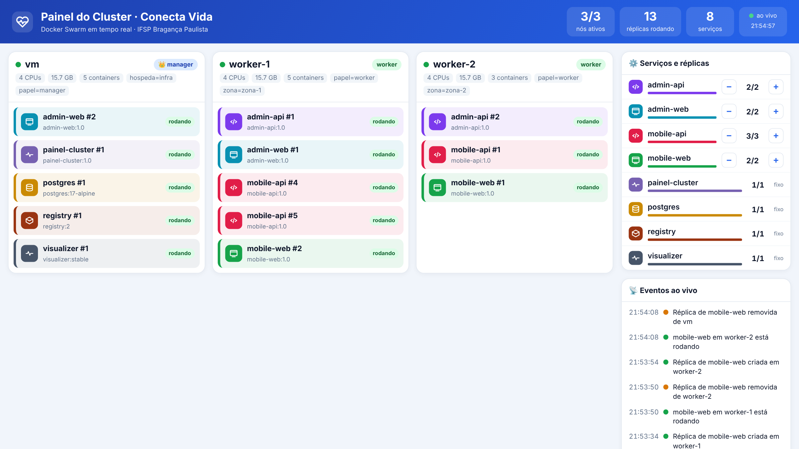

🎬 **Vídeo:** [Painel do Cluster: escala pelos botões e queda do worker-2 registrada no feed (115 s)](https://github.com/Conecta-Vida/Docker-Teste/blob/main/documentacao/midia/video-6-painel-do-cluster.mp4)

> Os botões fazem o mesmo que `docker service scale`. No próximo `docker stack deploy` vale de novo o número do `docker-compose.yml`.

### F5. O sistema funcionando (passo 3, 2 min)
- No **painel**, mostre o dashboard e, em **Campanhas**, crie uma campanha nova (ex.: "Vacinação contra a gripe").
- No **app**, atualize a página e mostre a campanha aparecendo para o cidadão, que pode se inscrever.
> "As duas telas conversam com APIs que estão rodando em vários nós do cluster, ao mesmo tempo."

🎬 **Vídeo:** [login no painel e no app, campanha criada no painel aparecendo no app (65 s)](https://github.com/Conecta-Vida/Docker-Teste/blob/main/documentacao/midia/video-5-sistema-funcionando.mp4)

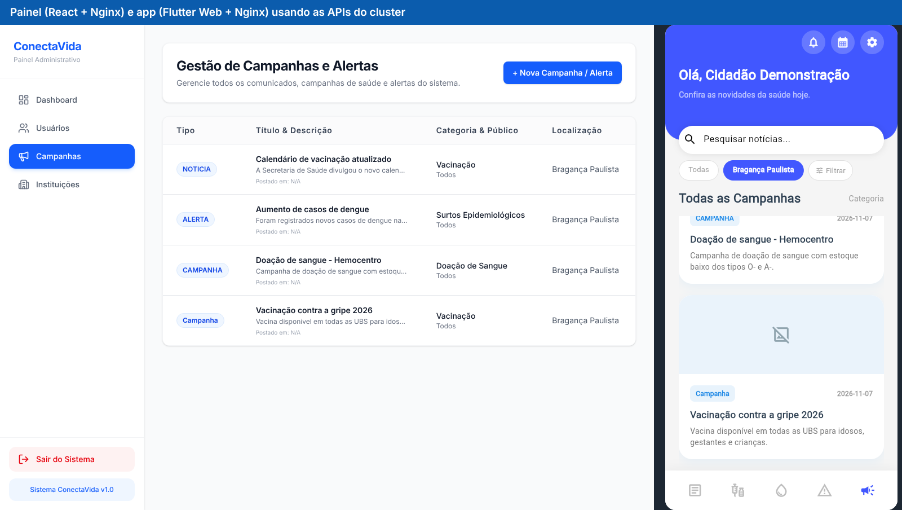

### F6. Requisito 3: Compose e variação de réplicas (passos 4 e 5, 3 min)
Antes do passo 4, mostre no VS Code o `docker-compose.yml`:
> "Isto é **infraestrutura como código**: os 7 serviços, a rede overlay, o volume do banco, os limites de memória e o número de réplicas estão descritos neste arquivo. Vejam a linha `replicas: ${MOBILE_API_REPLICAS:-3}`: o padrão são 3 cópias."

- **Passo 4:** o script reaplica o arquivo com 6 réplicas.
  > "Olhem o Visualizer: as caixas da mobile-api passaram de 3 para 6, distribuídas entre os nós."
- **Ainda no passo 4:** no próximo Enter, o script volta para 2 réplicas e as caixas somem.
- **Passo 5:** o script usa `docker service scale`.
  > "Também dá para escalar direto pelo terminal. O arquivo continua sendo a referência: no próximo deploy, vale o que está nele."

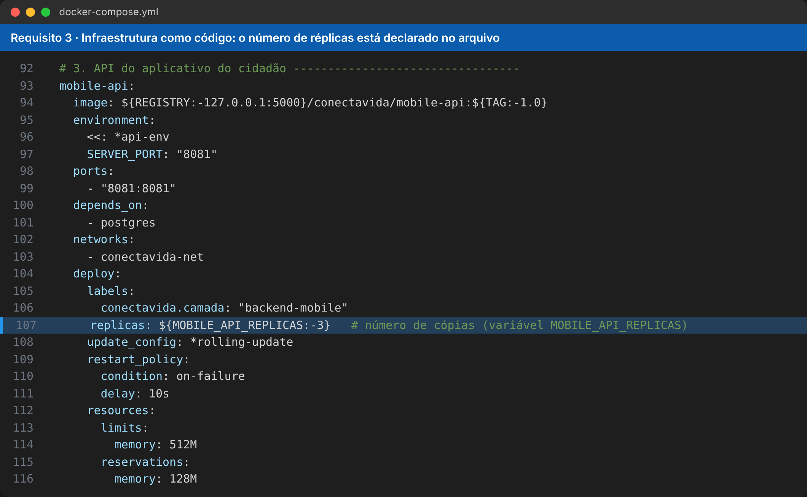

🎬 **Vídeo:** [mobile-api de 3 para 6 e de volta para 2 pelo docker-compose.yml (66 s)](https://github.com/Conecta-Vida/Docker-Teste/blob/main/documentacao/midia/video-2-replicas-pelo-compose.mp4)

🎬 **Vídeo:** [admin-api de 2 para 4 com docker service scale (46 s)](https://github.com/Conecta-Vida/Docker-Teste/blob/main/documentacao/midia/video-3-escala-pelo-terminal.mp4)

### F7. Extra: alta disponibilidade (passo 6, 1 min)
> "E se uma máquina cair?"

O script desliga o `worker-2`. Em cerca de 30 segundos ele fica vermelho no Visualizer e as réplicas dele reaparecem nos outros nós. Atualize o painel para mostrar que o sistema continua funcionando. No próximo Enter o worker é religado.

🎬 **Vídeo:** [worker-2 cai, as réplicas migram, e depois ele volta (75 s)](https://github.com/Conecta-Vida/Docker-Teste/blob/main/documentacao/midia/video-4-queda-de-maquina.mp4)

### F8. Fechamento (passo 7, 30 s)
> "Atendemos os três requisitos: **Dockerfiles** para 5 serviços, **cluster Swarm com 3 nós em Docker-in-Docker**, e **Docker Compose como infraestrutura como código**, variando réplicas e acompanhando tudo pelo **Docker Visualizer** e pelo nosso **Painel do Cluster**, o diferencial do grupo. Obrigado!"

---

## Parte G: divisão para 3 apresentadores

| Quem | Partes | Tempo | Fica no controle de |
|---|---|---|---|
| **Pessoa 1** | Abertura e **Requisito 1: Dockerfiles** (F1 e F2) | ~4 min | VS Code (mostra `admin-api/Dockerfile` e `admin-web/Dockerfile`) |
| **Pessoa 2** | **Requisito 2: Swarm**, **diferencial (Painel do Cluster)** e sistema funcionando (F3, F4, F4b e F5) | ~5 min | Git Bash (`apresentar`, passos 1 a 3) e navegador (Painel do Cluster, painel admin e app) |
| **Pessoa 3** | **Requisito 3: Compose e réplicas**, queda de máquina e fechamento (F6, F7 e F8) | ~4 min | VS Code (`docker-compose.yml`) e Git Bash (passos 4 a 7) |

**Dicas:**
- Um só computador e um só terminal: quem está falando pede para o colega apertar Enter, ou assume o teclado na sua vez.
- A Pessoa 2 já deixa o painel e o app logados antes de começar.
- Se perguntarem sobre o registry: "É um depósito de imagens dentro do cluster. Construímos as imagens no manager e os workers baixam de lá." Para mostrar: `curl http://localhost:5000/v2/_catalog`.

---

## Parte H: comandos avulsos (se quiser fazer na mão)

| Para | Comando |
|---|---|
| Ver nós, serviços e réplicas | `./infra/swarm/seminario.sh status` |
| Mudar réplicas pelo compose | `./infra/swarm/seminario.sh replicas mobile-api 6` |
| Escalar pelo terminal (6/4/2) | `./infra/swarm/seminario.sh escalar` |
| Escalar um serviço específico | `docker service scale conectavida_mobile-api=6` |
| Desligar o worker-2 | `./infra/swarm/seminario.sh falha` |
| Religar o worker-2 | `./infra/swarm/seminario.sh recuperar` |
| Ver os nós | `docker node ls` |
| Ver onde cada réplica está | `docker stack ps conectavida` |
| Ver o log de uma API | `docker service logs conectavida_admin-api` |

---

## Parte I: se algo der errado

| Problema | Solução |
|---|---|
| O Windows pergunta "com qual aplicativo abrir o .sh" | Você está no PowerShell. Use o **Git Bash**. |
| `docker: command not found` ou erro de conexão | Abra o Docker Desktop e espere ficar pronto. |
| Alguma caixa vermelha logo depois do `subir` | Normal: as APIs reiniciam até o banco ficar pronto. Espere 1 minuto. |
| Painel diz "Não foi possível conectar à API" | Espere 1 minuto e confira com `./infra/swarm/seminario.sh status`. |
| Os workers não entram no cluster | Rode `docker swarm leave --force` e depois `./infra/swarm/seminario.sh subir`. |
| Depois do `falha`, o worker não volta | `./infra/swarm/seminario.sh recuperar` |
| Quer recomeçar do zero | `./infra/swarm/seminario.sh derrubar --apagar-dados` e depois `./infra/swarm/seminario.sh subir` |
| Importação do Supabase: "password authentication failed" | Usuário `postgres.pborxjuuexiqollesfxw`, porta 5432 e senha atual em `SUPABASE_DB_PASSWORD`. |
| Nada funciona na hora da apresentação | Use os vídeos e fotos da **Parte K** (plano B). |

---

## Parte J: depois da apresentação

Para desligar tudo e liberar memória:

```bash
./infra/swarm/seminario.sh derrubar
```

Para sair do modo Swarm também:

```bash
docker swarm leave --force
```

Mais detalhes técnicos (cada Dockerfile e o compose explicados bloco a bloco): `documentacao/DOCKER_SWARM.md`.

---

## Parte K: fotos e vídeos (plano B e slides)

Gravados com o projeto rodando num cluster de 3 nós (manager + 2 workers Docker-in-Docker). Arquivos em [`documentacao/midia/`](midia/).

### Vídeos

| Vídeo | Mostra | Usar em |
|---|---|---|
| [video-1-cluster-3-nos.mp4](https://github.com/Conecta-Vida/Docker-Teste/blob/main/documentacao/midia/video-1-cluster-3-nos.mp4) | `docker node ls` e o Visualizer com os 3 nós | Requisito 2 |
| [video-2-replicas-pelo-compose.mp4](https://github.com/Conecta-Vida/Docker-Teste/blob/main/documentacao/midia/video-2-replicas-pelo-compose.mp4) | mobile-api 3 → 6 → 2 réplicas pelo `docker-compose.yml` | Requisito 3 |
| [video-3-escala-pelo-terminal.mp4](https://github.com/Conecta-Vida/Docker-Teste/blob/main/documentacao/midia/video-3-escala-pelo-terminal.mp4) | admin-api 2 → 4 → 2 com `docker service scale` | Requisito 3 |
| [video-4-queda-de-maquina.mp4](https://github.com/Conecta-Vida/Docker-Teste/blob/main/documentacao/midia/video-4-queda-de-maquina.mp4) | worker-2 cai e as réplicas migram para os outros nós | Extra |
| [video-5-sistema-funcionando.mp4](https://github.com/Conecta-Vida/Docker-Teste/blob/main/documentacao/midia/video-5-sistema-funcionando.mp4) | painel cria uma campanha e ela aparece no app | Sistema |
| [video-6-painel-do-cluster.mp4](https://github.com/Conecta-Vida/Docker-Teste/blob/main/documentacao/midia/video-6-painel-do-cluster.mp4) | **Diferencial:** Painel do Cluster escalando pelos botões e registrando a queda do worker-2 | Diferencial |

> No GitHub, clique no vídeo e depois em **View raw** (ou no botão de download) para baixar o `.mp4` e colocar nos slides.

### Fotos

| Foto | Mostra |
|---|---|
| [01-dockerfile-admin-api.png](midia/01-dockerfile-admin-api.png) | Dockerfile multi-stage da admin-api |
| [02-dockerfile-admin-web.png](midia/02-dockerfile-admin-web.png) | Dockerfile do painel (Node + Nginx) |
| [03-imagens-alpine.png](midia/03-imagens-alpine.png) | As 4 imagens, Alpine Linux e usuário sem root |
| [04-docker-node-ls.png](midia/04-docker-node-ls.png) | Os 3 nós do Swarm |
| [05-visualizer-3-nos.png](midia/05-visualizer-3-nos.png) | Visualizer com os serviços distribuídos |
| [06-compose-replicas.png](midia/06-compose-replicas.png) | Réplicas no docker-compose.yml |
| [07-compose-postgres.png](midia/07-compose-postgres.png) | Banco fixo no manager (constraint) |
| [08-registry.png](midia/08-registry.png) | Registry local com as imagens |
| [09-painel-login.png](midia/09-painel-login.png) | Login do painel admin |
| [10-painel-dashboard.png](midia/10-painel-dashboard.png) | Dashboard |
| [11-painel-campanhas.png](midia/11-painel-campanhas.png) | Campanhas e alertas |
| [12-painel-usuarios.png](midia/12-painel-usuarios.png) | Usuários |
| [13-painel-instituicoes.png](midia/13-painel-instituicoes.png) | Instituições de saúde |
| [14-app-login.png](midia/14-app-login.png) | Login do app |
| [15-app-inicio.png](midia/15-app-inicio.png) | App mostrando o alerta ao cidadão |
| [16-sistema-funcionando.png](midia/16-sistema-funcionando.png) | Campanha criada no painel aparecendo no app |
| [17-painel-do-cluster.png](midia/17-painel-do-cluster.png) | **Diferencial:** Painel do Cluster Conecta Vida |

